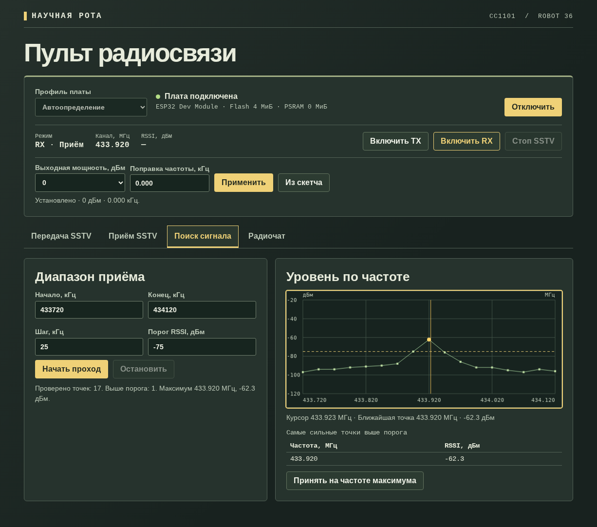
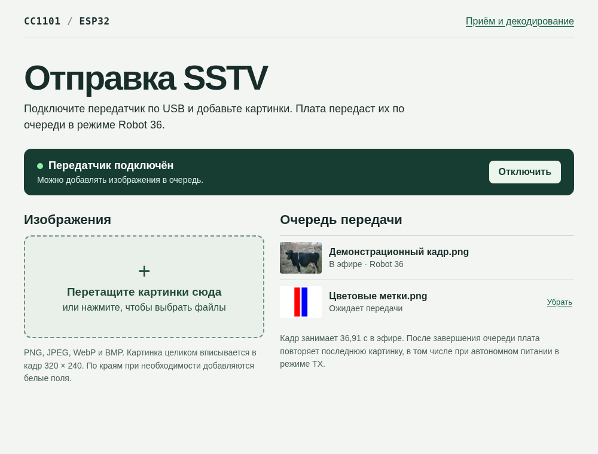

# Научная рота · Пульт радиосвязи ESP32 + CC1101

**CC1101_SSTV** — проект для передачи цветных изображений по радио с помощью **ESP32 Dev Module** или **ESP32-S3 N16R8** и модуля **CC1101**. Используется телевидение с медленной развёрткой (SSTV, *Slow Scan Television*) в режиме **Robot 36**. ESP32 считывает пиксели из памяти и формирует последовательность тонов, а CC1101 передаёт её на частоте **433,920 МГц**. На приёмной стороне достаточно SDR-приёмника или радиостанции с узкополосной ЧМ (NFM) и SSTV-декодера. Из звука приёмника декодер восстанавливает кадр **320 × 240** примерно за **37 секунд**. Второй комплект ESP32 + CC1101 умеет искать сигнал по уровню, записывать его на компьютер через USB и восстанавливать картинку из WAV с помощью комплектного браузерного конвертера.

[Скачать проект целиком (ZIP)](https://github.com/Anton778/CC1101_SSTV/archive/refs/heads/main.zip) · [Общий пульт](#пульт-научной-роты) · [Отправка картинок через USB](#отправка-картинок-через-usb) · [Команды COM-порта](#команды-com-порта) · [Запись WAV и получение PNG](#опыт-с-двумя-платами-и-запись-без-звуковой-карты) · [Задания для занятия](#5-задания-для-занятия)

## Пульт научной роты

Распакуйте проект целиком. Один раз прошейте каждую станцию по таблице ниже. Перенесите индивидуальную поправку CC1101 в `FREQ_OFFSET_KHZ`. На компьютере откройте **`tools/station/index.html`** из распакованной папки в настольном Chrome или Edge. Закройте монитор порта Arduino IDE, выберите профиль и нажмите **«Подключить плату»**. Плата сообщит тип процессора, объём Flash и доступной PSRAM. При явном выборе пульт проверит семейство процессора до отправки команд. Автоопределение подходит для смешанного комплекта. Все вкладки и отдельное окно чата используют одно USB-соединение.

| Плата | Настройки в Arduino IDE |
| --- | --- |
| Классический ESP32-WROOM-32 | **ESP32 Dev Module**, Flash Size **4MB**, Partition Scheme **Default 4MB with spiffs**. Подключить USB–UART. |
| ESP32-S3 N16R8 | **ESP32S3 Dev Module**, Flash Size **16MB**, PSRAM **OPI PSRAM**, Partition Scheme **Default 4MB with spiffs**. На двухпортовой плате для разъёма **UART** оставить **USB CDC On Boot → Disabled**. Для разъёма **USB** выбрать **Hardware CDC and JTAG**, **USB CDC On Boot → Enabled**, Upload Mode **UART0 / Hardware CDC**. |

Одинаковая таблица разделов на обеих платах выделяет место для приложения и LittleFS в первых 4 МиБ. На S3 физический объём Flash остаётся 16 МиБ. Выбор профиля в браузере проверяет уже прошитую плату. Цель сборки задаёт Arduino IDE. [Описание DevKitC-1 от Espressif](https://docs.espressif.com/projects/esp-dev-kits/en/latest/esp32s3/esp32-s3-devkitc-1/user_guide_v1.0.html) · [Настройки встроенного USB](https://docs.espressif.com/projects/arduino-esp32/en/latest/tutorials/cdc_dfu_flash.html)

| Задача | Действия в общем пульте |
| --- | --- |
| Передать картинку | **Включить TX → Передача SSTV**. Перетащите файлы в очередь. Следующий файл загрузится после последней строки предыдущего. **Стоп SSTV** прерывает текущий кадр и останавливает повторы. |
| Принять картинку | На второй станции откройте **Приём SSTV**, задайте канал в МГц и нажмите **Принять и декодировать**. Пульт включит RX, проверит поток и восстановит первый полный кадр. Можно сохранить WAV и PNG или открыть WAV с SDR. Запустите запись до передачи. Для уже работающего передатчика со штатной паузой оставьте 90 с. |
| Найти сигнал | **Поиск сигнала**. Укажите начало, конец и шаг в кГц, порог в дБм. **Начать проход** включает приём. График и таблица показывают измерения и точки строго выше порога. В конце можно перейти на приём на частоте максимума. |
| Обменяться текстом | На обоих постах откройте **Радиочат**, задайте одинаковый канал и разные позывные, затем нажмите **Включить чат**. Введите сообщение и нажмите **Передать**. Кнопка **В отдельное окно** выносит переписку рядом с пультом. |
| Сравнить кадры со свипом | **Опыт со свипом → Сравнить два кадра**. Браузер обработает полученную запись или контрольные полосы и покажет исходное и искажённое изображения рядом. Нижняя и верхняя границы в Гц относятся к звуку после ЧМ-демодуляции. В этом опыте радиомодуль не излучает помеху. |

*Пример на моделируемых данных. При пороге −75 дБм точка с уровнем −62,3 дБм появилась в таблице, точка с уровнем ровно −75 дБм в таблицу не вошла.*

**Резервный канал** по умолчанию настроен на **433,500 МГц**, SSTV — на **433,920 МГц**. Частоту чата можно менять в пульте до входа в режим. Значение при следующем включении задаёт `CHAT_FREQ_MHZ`. Один CC1101 обслуживает один режим. Переход в RX или чат прерывает текущий кадр SSTV. Переключение вкладки в браузере само по себе режим не меняет. Чтобы возобновить приём изображений после переписки, нажмите **Включить RX**. Для одновременной работы SSTV и чата подключите второй комплект ESP32 + CC1101 на каждом посту. Откройте пульт во второй вкладке, выберите COM-порт второй платы и включите на ней чат. Первая вкладка продолжит работать с SSTV. В режиме чата используются пакетная 2-FSK, скорость 9600 бит/с, девиация 5 кГц, полоса приёма 58 кГц и аппаратная проверка CRC. Позывной и текст вместе занимают до 192 байт UTF-8. Приёмник показывает сообщение после получения всех его частей. Статус «Передано в эфир» выдаёт передающий пост. Ответ собеседника позволяет проверить двустороннюю связь.

*Так выглядит штатный кадр до передачи по радио. Предпросмотр восстановлен из `image_data.h` с тем же выбором строк, что и в скетче.*

## 1. Подготовка изображения

Распакуйте ZIP проекта. Переименуйте папку `CC1101_SSTV-main`, в которой лежит скетч, в **`SSTV_Robot36_DDS`**. Откройте [SSTV_Robot36_DDS.ino](SSTV_Robot36_DDS.ino) в Arduino IDE. Рядом с ним должны находиться [image_data.h](image_data.h) и **вся папка [src](src/)**. Arduino IDE сама соберёт файлы из `src`. Для первой проверки можно передать штатную картинку выше.

### Отправка картинок через USB

Для соревнований достаточно один раз прошить передающую плату. Дальше участник перетаскивает файл в окно отправителя, а ESP32 получает картинку по USB и сразу начинает новый кадр Robot 36.

1. Загрузите актуальный скетч по [инструкции для Arduino IDE](#3-сборка-и-загрузка-в-arduino-ide). Если CC1101 уже откалиброван, перенесите свои значения `CARRIER_FREQ_MHZ`, `FREQ_OFFSET_KHZ` и `TX_POWER_DBM` перед этой однократной загрузкой.
2. Закройте монитор и плоттер порта Arduino IDE. На компьютере откройте **`tools/sender/index.html` из распакованного проекта** в настольном **Chrome или Edge**. Соседние файлы должны лежать в той же папке. Интернет для работы не требуется.
3. Нажмите **«Подключить передатчик»** и выберите COM-порт передающей ESP32. Подготовьте приёмник в режиме Robot 36, чтобы он успел принять начало кадра.
4. Перетащите в окно **одну или несколько картинок** либо нажмите на область выбора файлов. Поддерживаются PNG, JPEG, BMP и WebP. Миниатюра показывает границы будущего кадра. Браузер сохраняет пропорции, вписывает рисунок в 320 × 240, заполняет поля и прозрачность белым и формирует компактный JPEG. Для координат и позывных удобен исходник 4:3 с крупным контрастным текстом.
5. Следите за строкой нужного файла. **«Загрузка по USB»** показывает долю байтов, подтверждённых платой. **«В эфире»** появляется после запуска передатчика, **«Передано · 240 строк»** — после последней строки. Это подтверждение передающей ESP32. Результат приёма видно на отдельном декодере.

Для двух команд добавьте `team-1.png` и `team-2.jpg` одним выделением. Сначала в эфир выйдет первый файл. После его полного кадра браузер загрузит второй и запустит передачу, пропуская обычную 10-секундную паузу повтора. Новые файлы можно добавлять, пока предыдущий в эфире. Оставьте окно открытым до завершения очереди. Уже идущий автономный повтор может прерваться при заказе первого файла из очереди.

Каждый радиокадр занимает **36,91 с**. Загрузка файла по USB добавляет время, зависящее от размера JPEG. Например, для 20 КиБ при 115200 бод требуется около **2,4 с только на передачу данных** с учётом Base64, плюс подтверждения блоков, проверка и запись во флеш. На первом запуске плата также создаёт LittleFS в пустом разделе.

**Без компьютера.** При штатном `RADIO_MODE = SSTV_TX` плата повторяет последний успешно загруженный кадр, в том числе после отключения питания. До первой загрузки передаётся встроенная картинка. При обрыве до завершения загрузки плата отбрасывает недостающий кадр по тайм-ауту около 12 с. Предыдущая картинка сохраняется. При обрыве уже в эфире ESP32 самостоятельно заканчивает текущий кадр, если питание сохранено. Остальные файлы очереди находятся в браузере.

### Настройки станции и учебный цикл

Загрузите один и тот же скетч в обе платы. При штатных настройках подача питания запускает повторяющуюся передачу, даже если плата питается от внешнего источника. Режимы во время занятия выбираются командами в мониторе порта. В функции `loop()` можно проследить один проход по частотам и изменить алгоритм поиска.

| Строка скетча | Что меняется |
| --- | --- |
| `RADIO_MODE = SSTV_TX` | Начальный режим при подаче питания. `SSTV_TX` автоматически передаёт картинку, `SSTV_RX` слушает канал, `SSTV_SCAN` циклически обходит диапазон до команды `RX` или `TX`. |
| `CARRIER_FREQ_MHZ = 433.920` | Частота канала в МГц. На передатчике и приёмнике задайте один номинал. |
| `CHAT_FREQ_MHZ = 433.500` | Резервный канал переписки в МГц. В пульте можно выбрать другой канал для текущего занятия. |
| `TX_POWER_DBM = 0` | Мощность передатчика в дБм. RadioLib 8.0.0 поддерживает значения −30, −20, −15, −10, 0, 5, 7 и 10. |
| `FREQ_OFFSET_KHZ = 0.0` | Поправка конкретного CC1101 в кГц. Плюс повышает частоту, минус понижает. Действует и на передачу, и на приём. |
| `FRAME_PAUSE_S = 10` | Пауза в секундах от конца кадра до начала следующего. Сам кадр длится 36,91 с. |
| `SCAN_START_KHZ`, `SCAN_END_KHZ`, `SCAN_STEP_KHZ` | Начало, конец и шаг прохода приёмника **в кГц**. В примере 433720…434120 с шагом 25. |
| `SCAN_THRESHOLD_DBM = -75` | Порог RSSI в дБм для команды `SCAN` без аргументов и для поиска при включении. |

### Встроенная картинка для прошивки

Этот вариант нужен, если вы хотите заменить заводской кадр для плат, которым ещё не отправляли изображение по USB. Для обычной смены картинки используйте отправитель выше. Штатную картинку также можно вернуть обычной отправкой файла [robot36-preview.png](docs/robot36-preview.png).

1. Подготовьте файл **PNG, JPG/JPEG или BMP**. Чтобы сохранить пропорции на экране приёмника, заранее кадрируйте изображение до **4:3**, например до 640 × 480 пикселей.
2. Запустите **`SSTV_Converter.exe`** в Windows x64. Python устанавливать отдельно не требуется. В окне «Выберите картинку для передачи по SSTV» откройте подготовленный файл.
3. Конвертер автоматически сохранит **`image_data.h` в папке исходной картинки**. Полный путь появится в сообщении «Готово!». При повторной обработке в той же папке программа перезаписывает этот файл.
4. Скопируйте полученный `image_data.h` в рабочую папку `SSTV_Robot36_DDS` рядом с `.ino`, заменив рабочую копию примера. Чтобы изменить встроенный кадр, заново загрузите скетч в ESP32. Сохранённая по USB картинка имеет приоритет при включении.

Конвертер масштабирует весь рисунок до **320 × 256** и записывает пиксели по строкам в массив `image_map`. Один пиксель занимает 16 бит в формате **RGB565** — 5 бит красного, 6 зелёного и 5 синего. Массив из 81 920 значений `uint16_t` занимает 160 КиБ в памяти прошивки. При передаче скетч выбирает из него 240 строк и по значениям пикселей формирует звуковые тоны SSTV.

## 2. Подключение CC1101

Понадобятся **ESP32-WROOM-32** или **ESP32-S3 N16R8**, радиомодуль **CC1101 на диапазон 433 МГц**, антенна этого диапазона и USB-кабель для передачи данных. Соедините платы при отключённом питании.

| CC1101 | ESP32 Dev Module | ESP32-S3 N16R8 | Назначение |
| --- | --- | --- | --- |
| VCC | 3V3 | 3V3 | Питание 3,3 В |
| GND | GND | GND | Общий провод |
| SCK / SCLK | GPIO18 | GPIO12 | Тактовая линия SPI |
| SO / MISO | GPIO19 | GPIO13 | От CC1101 к ESP32 |
| SI / MOSI | GPIO23 | GPIO11 | От ESP32 к CC1101 |
| CSN / CS | GPIO21 | GPIO21 | Выбор радиомодуля |
| GDO0 | GPIO4 | GPIO4 | Тоны в TX, демодулированный сигнал в RX, готовность пакета чата |
| GDO2 | GPIO27 | GPIO5 | Окончание передачи пакета чата |

Подключите антенну до подачи питания. В режиме `SSTV_TX` передача начинается автоматически после загрузки прошивки. Для работы в эфире выберите частоту, мощность и режим работы, разрешённые в месте проведения опыта.

## 3. Сборка и загрузка в Arduino IDE

1. В настройках Arduino IDE добавьте в список дополнительных адресов менеджера плат `https://espressif.github.io/arduino-esp32/package_esp32_index.json`. В менеджере плат выберите **esp32 by Espressif Systems**. Сборка проверена с версиями **3.1.3**, **3.3.12** и **4.0.0**. [Инструкция Espressif](https://docs.espressif.com/projects/arduino-esp32/en/latest/installing.html)
2. Через менеджер библиотек установите **RadioLib** автора **Jan Gromeš**, версия **8.0.0**. Скетч использует интерфейс конфигурации `ConfigFSK_t` и вызов `transmitDirectAsync()`. [RadioLib 8.0.0](https://github.com/jgromes/RadioLib/releases/tag/8.0.0)
3. Откройте `SSTV_Robot36_DDS/SSTV_Robot36_DDS.ino`. В Arduino IDE выберите свою плату, схему разделов и USB-порт по таблице в разделе «Пульт научной роты». Прошивка использует этот раздел для LittleFS. Занятый раздел с другой файловой системой автоматически не форматируется.
4. Нажмите **Проверить**, затем **Загрузить**. Откройте монитор порта на **115200 бод**. При успешном запуске появляется `radio.begin = 0`. Для SSTV и поиска дополнительно выводится `setFrequencyDeviation = 0`. В TX появятся `DDS tick: 80000 Гц`, а при начале кадра — `TX START` и `transmitDirectAsync = 0`. В RX появятся `receiveDirectAsync = 0` и показания RSSI в дБм.

Скетч собран для **ESP32 Dev Module** и **ESP32S3 Dev Module (N16R8)** на каждой из трёх указанных версий с RadioLib 8.0.0. Загруженные из браузера изображения обрабатывает встроенный JPEG-декодер ESP32. Распиновка выбирается при компиляции в [BoardProfile.h](src/BoardProfile.h).

### Команды COM-порта

В Arduino IDE откройте **Монитор порта**, выберите **115200 бод** и окончание строки **«Новая строка»** или **«Оба NL и CR»**. Вводите по одной команде и нажимайте Enter. Регистр букв свободный. Для дробной частоты используйте точку.

| Команда | Действие |
| --- | --- |
| `RX` | Прерывает передачу или поиск и включает приём на последнем выбранном канале. После включения питания это `CARRIER_FREQ_MHZ`. |
| `RX 433.920` | Включает приём на указанной частоте в **МГц**. Поправка `FREQ_OFFSET_KHZ` применяется автоматически. |
| `TX` | Возвращает передатчик на `CARRIER_FREQ_MHZ` с мощностью `TX_POWER_DBM`. При включённых повторах передаёт картинку с начала. |
| `Stop SSTV` | Прерывает текущий кадр и отключает повторы. В режиме TX радиомодуль переходит в ожидание. Допустима запись `Stop_SSTV`. |
| `Start_SSTV` | В режиме TX запускает картинку с заголовка VIS и включает повторы. В паузе новый кадр начинается сразу. Во время кадра передача продолжается. |
| `SCAN 433720 434120 -75 25` | В RX выполняет один проход. Аргументы по порядку — начало **в кГц**, конец **в кГц**, порог **в дБм**, шаг **в кГц**. Шаг можно опустить, тогда используется `SCAN_STEP_KHZ`. |
| `SCAN` | В RX выполняет один проход с четырьмя значениями из скетча. После прохода плата возвращается на прежнюю частоту приёма. |
| `CHAT [частота_МГц]` | Включить пакетный приём чата на резервном канале. Обе станции должны выбрать одинаковую частоту. |
| `INFO` | Показать семейство платы, режим, номиналы каналов и объёмы памяти. |
| `STATUS`, `HELP` | Показать текущее состояние станции или напечатать список команд. |

Например, во время автономной передачи введите `RX`. Плата прервёт кадр и начнёт показывать RSSI. Введите `TX`, и начнётся новый кадр. Если вы уже ввели `Stop SSTV`, остановка сохраняется при переключении режимов. Для возобновления выберите `TX` и введите `Start_SSTV`. При следующей подаче питания действуют настройки скетча.

При передаче заголовка плата опрашивает порт, пока таймер воспроизводит тон. При передаче изображения плата читает команды между строками длительностью 150 мс. В паузе между кадрами порт также доступен.

## 4. Приём изображения

| Настройка | Значение для штатного скетча |
| --- | --- |
| Частота приёмника | **433,920 МГц** |
| Демодуляция | **NFM** (узкополосная ЧМ) |
| Полоса канального фильтра SDR | **12–15 кГц** |
| Шумоподавитель (squelch) | **Выключен**, чтобы сохранить начало кадра |
| Режим SSTV-декодера | **Robot 36** или автоопределение по заголовку VIS |

**На телефоне.** Откройте приложение Robot36 для Android, выберите микрофон и разрешите доступ к нему. Поднесите телефон к динамику радиостанции или компьютера с SDR и установите умеренную громкость. [Robot36 для Android](https://github.com/xdsopl/robot36)

**На компьютере.** Направьте звуковой выход SDR-программы на вход SSTV-декодера, например MMSSTV для Windows. При использовании виртуального аудиокабеля выберите его воспроизводящий конец в SDR-программе, а записывающий — в декодере. [MMSSTV](https://hamsoft.ca/pages/mmsstv.php)

В начале передачи ESP32 посылает заголовок **VIS = 8** длительностью 0,91 с. Затем идут **240 строк по 150 мс**. Кадр вместе с заголовком занимает **36,91 с**, после чего передатчик делает паузу (по умолчанию **10 с**) и повторяет изображение. Если декодер включился в середине передачи, оставьте его работать до начала следующего кадра.

### Опыт с двумя платами и запись без звуковой карты

1. Загрузите общий скетч на обе платы. Первая начнёт передавать автоматически. В мониторе порта второй введите `RX 433.920`, подставив номинальную частоту первой платы в МГц. У каждого CC1101 своя `FREQ_OFFSET_KHZ`.
2. Проверьте вторую плату в мониторе порта на **115200 бод**. Раз в 250 мс появляется **RSSI** — уровень принятого сигнала в дБм. Например, −55 дБм выше −85 дБм. Сравните кадр и паузу, затем **закройте монитор порта**, чтобы освободить порт для записи.
3. На компьютере откройте файл [tools/receiver/index.html](tools/receiver/index.html) **из распакованной папки проекта** в настольном Chrome или Edge. Оставьте соседние файлы конвертера в той же папке. Обработка идёт локально. Компьютеру достаточно USB-соединения с приёмной ESP32.
4. В разделе **«Запись с платы»** при необходимости введите канал приёма в МГц. Так конвертер установит его заново, даже если плата перезапустится при открытии порта. Пустое поле оставляет текущий канал. Нажмите **«Выбрать порт и записать»** и выберите порт второй ESP32. Конвертер сам переводит выбранную плату в RX и начинает запись. Удобно начать запись до включения передатчика. Для уже работающего передатчика со штатной паузой 10 с оставьте **90 с**: даже если начать сразу после заголовка, в файл попадёт следующий полный кадр. Если вы увеличили паузу, начните запись до передачи. После проверки целостности нажмите **«Сохранить принятый WAV»**.
5. Дождитесь автоматического декодирования и нажмите **«Сохранить PNG»**. Для отдельного WAV выберите его в разделе **«Изображение из WAV»** и нажмите **«Декодировать кадр»**. Конвертер ищет заголовок **VIS = 8**, проверяет чётность, синхронизируется по строкам и восстанавливает первый полный распознанный кадр **320 × 240**. Под изображением указаны время начала заголовка и число строк, в которых найден синхроимпульс.

Для проверки без плат нажмите **«Скачать контрольный WAV»** и выполните шаг 5. На экране появятся восемь цветных полос, в нижней половине кадра их порядок обращён. Можно открыть и запись звукового выхода SDR: обычный WAV PCM или float32, моно или стерео, 8–96 кГц, до 180 с. Для стереозаписи программа усредняет левый и правый каналы.

В общем пульте обе операции доступны через одно подключение. Отдельные страницы **`tools/sender`** и **`tools/receiver`** также входят в комплект. Прежний Windows-конвертер `SSTV_Converter.exe` остаётся в комплекте для подготовки встроенного `image_data.h`. ESP32 считывает уровень GDO0 с частотой 32 кГц, упаковывает восемь отсчётов в байт и отправляет их через USB. Компьютер сохраняет монофонический WAV PCM16. Для записи достаточно уже подключённого GPIO4.

### Приём через линейный вход

Для приёма через **линейный вход компьютера** соедините GDO0 через резистор 10 кОм с верхним выводом резистора 1 кОм, а его нижний вывод — с GND. Из точки соединения резисторов подайте сигнал через неполярный конденсатор 1 мкФ на один канал LINE IN, общий контакт входа соедините с GND. Такой делитель снижает размах примерно до 0,3 В. В MMSSTV выберите этот линейный вход и режим Robot 36.

### Подстройка передатчика под канал рации

Если вы уже откалибровали передатчик в предыдущей версии, перенесите значение `TX_FREQ_OFFSET_KHZ` без изменения знака в `FREQ_OFFSET_KHZ`.

1. Для нового модуля настройте рацию на нужный канал, укажите ту же частоту в `CARRIER_FREQ_MHZ` и загрузите прошивку с `FREQ_OFFSET_KHZ = 0.0`. С нуля следует начать и при переходе с самой первой версии, где `RADIOLIB_UNIT_MEGA(433.920f)` из RadioLib 8.0.0 задавал 433,000 МГц.
2. Во время передачи измерьте на откалиброванном SDR центр спектра сигнала. Например, если при канале **433,920 МГц** центр виден на **433,9275 МГц**, сигнал выше на 7,5 кГц. Введите `FREQ_OFFSET_KHZ = -7.5`. При повторной подстройке прибавьте к текущей поправке разность «частота канала минус измеренный центр», выраженную в кГц.
3. Снова загрузите скетч и проверьте приём на том же канале рации. В мониторе порта на **115200 бод** появятся номинал канала, поправка и частота, переданная в RadioLib. В примере последнее значение составит **433,912500 МГц**. Фактический центр сигнала проверьте по SDR.

Если под рукой только рация, откройте её шумоподавитель и подбирайте поправку небольшими шагами, например по 1 кГц в обе стороны. Сравнивайте устойчивость декодирования полного кадра Robot 36 при одной и той же настройке рации.

## 5. Задания для занятия

### Найти частоту учебного передатчика

1. Преподаватель включает свой передатчик на одном из учебных каналов. На второй плате введите `RX`, затем `SCAN 433720 434120 -75 25`. Приёмник проверит 17 точек. Каждая строка содержит частоту и средний RSSI. Метка **СИГНАЛ** появляется только для значений строго выше −75 дБм. Например, при −60 дБм метка появится, при −75 и −90 дБм строка останется без метки.
2. В конце прохода станция выводит число точек выше порога и частоту самой сильной из них. Если таких точек нет, появляется отдельное сообщение. Несколько соседних отметок могут соответствовать одному передатчику. Для повторного прохода снова введите команду. Чтобы прервать длинный проход, введите `RX`.
3. Измените шаг с 25 до 50 кГц прямо в команде. Предскажите число точек и проверьте его по выводу порта. В основном скетче найдите цикл `for` и условие `rssi > scan.thresholdDbm`. Добавьте счётчик всех измерений и сравните его с числом измерений выше порога во время передачи и в паузе.
4. При полосе фильтра около 58 кГц соседние точки могут иметь близкие уровни. Если максимумы пришлись на 433895, 433920 и 433945 кГц, проверьте среднюю командой `RX 433.920`. Запишите полный кадр и декодируйте изображение. Узнаваемая картинка подтверждает приём нужного учебного передатчика.

### Исследовать помеху со свипом в записи

Откройте чистый WAV, декодируйте его и сохраните исходный PNG. В разделе **«Опыт со свипом»** задайте, например, границы **1100–2300 Гц**, период **2 с** и амплитуду **60 %** от пика исходной записи. Нажмите **«Сохранить WAV со свипом»**. Откройте полученную копию с суффиксом `-sweep.wav` и декодируйте её тем же способом. Опыт моделирует добавление звуковой помехи **после ЧМ-демодуляции** и выполняется целиком на компьютере.

Параметры можно задать с клавиатуры. Разверните **«Ввести параметры свипа командой»** в конвертере и введите `WAV_SWEEP 1100 2300 -6 2`. Здесь 1100 и 2300 — границы звуковой частоты в герцах, −6 дБ — мощность тона относительно средней мощности выбранной записи, 2 с — полный период подъёма и спуска. При −6 дБ отношение мощностей примерно 1:4. Без последнего аргумента используется период 2 с. Команда создаёт копию WAV на компьютере и работает при отключённом радиомодуле.

Оба кадра ниже получены из одной контрольной фонограммы этим конвертером.

| Чистая запись | Копия со свипом 1100–2300 Гц, 2 с, 60 % |
| --- | --- |
|  |  |

В файле [sweep.js](tools/receiver/sweep.js) найдите цикл `for`. На каждом отсчёте он прибавляет тон к сигналу и изменяет частоту. У верхней границы `direction` становится −1, у нижней — +1. При периоде 2 с подъём занимает 1 с, спуск — ещё 1 с.

| Что изменить за один опыт | Что записать в отчёт |
| --- | --- |
| Амплитуда 0, 30 и 60 % при одном периоде | Сравните цвета полос и подпишите участки искажений. |
| Период 1, 2 и 4 с при одной амплитуде | Измерьте расстояние между повторяющимися искажениями в строках изображения. |
| Верхняя и нижняя границы звуковой частоты | Отметьте, распознался ли VIS и сколько строк сохранили синхронизацию. |

## Как формируется радиосигнал

Функции Arduino `setup()` и `loop()` находятся в [учебном скетче](SSTV_Robot36_DDS.ino). Настройкой CC1101 управляет [SstvRadio.cpp](src/SstvRadio.cpp). Проверка CRC32, преобразование JPEG в RGB565 и сохранение кадра во флеш находятся в [ImageStore.cpp](src/ImageStore.cpp). Генерация кадра находится в [Robot36Tx.cpp](src/Robot36Tx.cpp), разбор команд — в [StationCommands.cpp](src/StationCommands.cpp), запись GDO0 — в [RxCapture.cpp](src/RxCapture.cpp). Аппаратный таймер ESP32 с частотой **80 кГц** управляет прямым цифровым синтезом (DDS). На GPIO4 формируется меандр, частота которого меняется с сохранением фазы. CC1101 работает в асинхронном режиме 2-FSK с заданной девиацией **±2 кГц**. После ЧМ-демодуляции приёмник воспроизводит тоны SSTV. Импульс **1200 Гц** отмечает начало строки, тоны **1500–2300 Гц** кодируют яркость и цветность. Яркость передаётся в каждой строке, а компоненты цветности R−Y и B−Y чередуются.

Штатная выходная мощность 0 дБм соответствует 1 мВт.

## Диагностика первого запуска

| Наблюдение | Что проверить |
| --- | --- |
| При сборке не найден `src/SstvRadio.h`, `image_data.h` или функция `setup()` | Проверьте, что рядом с `.ino` находятся `image_data.h` и папка `src` целиком. |
| `esp_jpg_decode.h: No such file or directory` | Замените в своей папке скетча один файл [src/ImageStore.cpp](src/ImageStore.cpp) текущей версией из репозитория и снова нажмите **Проверить**. Отдельную библиотеку JPEG устанавливать не требуется. |
| Ошибка `static_assert` с упоминанием 320×256 | Повторите преобразование исходника штатным конвертером. Скетч ожидает ровно 81 920 пикселей RGB565. |
| Ошибка сборки в `timerBegin` или `ConfigFSK_t` | Проверьте выбранную плату, версию пакета ESP32 и версию RadioLib из раздела 3. |
| `radio.begin` возвращает ненулевой код | Проверьте питание 3,3 В, общий провод и четыре линии SPI. Сверьте маркировку SI и SO на модуле и убедитесь, что CSN подключён к GPIO21. |
| В спектре есть сигнал, но декодер не начинает кадр | Выберите NFM, подстройтесь по центру сигнала, отключите squelch и проверьте поступление звука на выбранный вход декодера до начала следующего VIS. |
| Конвертер не видит USB-порт | Откройте локальную страницу в настольном Chrome или Edge, закройте монитор и плоттер Arduino IDE, проверьте USB-кабель и загрузите прошивку с командами порта. |
| Отправитель не получает ответ от прежней прошивки | Один раз загрузите актуальный скетч с папкой `src`. Закройте монитор порта и выберите COM-порт передающей платы. |
| Загрузка или радиопередача прервалась | Проверьте USB-питание и статус файла в очереди. После восстановления соединения нажмите **Повторить** или **Убрать**. Если пропало только подтверждение, кадр мог дойти до приёмника. |
| При записи появилась ошибка `OVERRUN` или запрос повторить приём | Освободите порт, повторите запись с начала и дождитесь ссылки на полный WAV. |
| Конвертер сообщает об отсутствии VIS или обрыве кадра | Проверьте канал и поправку. Запустите приём до начала передачи и захватите все 36,91 с кадра. Сначала проверьте декодирование контрольного WAV. |
| Кадр распознаётся, но покрыт шумом | При близком передатчике уменьшите усиление SDR. При акустическом приёме снизьте громкость до исчезновения искажений. Для проверки звукового тракта на компьютере передайте звук через виртуальный аудиокабель. |

После каждого кадра монитор порта выводит фактическую длительность передачи, число опозданий больше 50 мкс и максимальное опоздание. Эти значения помогают отличить нарушения временной сетки на ESP32 от искажений на стороне приёма.
