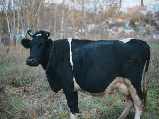

# Передача SSTV-изображений с ESP32 и CC1101

**CC1101_SSTV** — проект для передачи цветных изображений по радио с помощью **ESP32-WROOM-32** и модуля **CC1101**. Используется телевидение с медленной развёрткой (SSTV, *Slow Scan Television*) в режиме **Robot 36**. ESP32 считывает пиксели из памяти и формирует последовательность тонов, а CC1101 передаёт её на частоте **433,920 МГц**. На приёмной стороне достаточно SDR-приёмника или радиостанции с узкополосной ЧМ (NFM) и SSTV-декодера. Из звука приёмника декодер восстанавливает кадр **320 × 240** примерно за **37 секунд**.

[Скачать проект целиком (ZIP)](https://github.com/Anton778/CC1101_SSTV/archive/refs/heads/main.zip) · [Скачать конвертер для Windows x64](https://raw.githubusercontent.com/Anton778/CC1101_SSTV/main/SSTV_Converter.exe)

*Так выглядит штатный кадр до передачи по радио. Предпросмотр восстановлен из `image_data.h` с тем же выбором строк, что и в скетче.*

## 1. Подготовка изображения

Распакуйте ZIP проекта. Переименуйте папку `CC1101_SSTV-main`, в которой лежит скетч, в **`SSTV_Robot36_DDS`**. Откройте [SSTV_Robot36_DDS.ino](SSTV_Robot36_DDS.ino) в Arduino IDE. Рядом с ним должны находиться [image_data.h](image_data.h) и **вся папка [src](src/)**. Arduino IDE сама соберёт файлы из `src`. Для первой проверки можно передать штатную картинку выше.

### Пять настроек станции

На занятии достаточно менять значения справа от знака `=` в основном скетче и после каждого изменения снова загружать его в ESP32.

| Строка скетча | Что меняется |
| --- | --- |
| `RADIO_MODE = SSTV_TX` | `SSTV_TX` передаёт картинку. `SSTV_RX` включает приём и показывает уровень сигнала. |
| `CARRIER_FREQ_MHZ = 433.920` | Частота канала в МГц. На передатчике и приёмнике задайте один номинал. |
| `TX_POWER_DBM = 0` | Мощность передатчика в дБм. RadioLib 8.0.0 поддерживает значения −30, −20, −15, −10, 0, 5, 7 и 10. |
| `FREQ_OFFSET_KHZ = 0.0` | Поправка конкретного CC1101 в кГц. Плюс повышает частоту, минус понижает. Действует и на передачу, и на приём. |
| `FRAME_PAUSE_S = 10` | Пауза в секундах от конца кадра до начала следующего. Сам кадр длится 36,91 с. |

### Своя картинка

1. Подготовьте файл **PNG, JPG/JPEG или BMP**. Чтобы сохранить пропорции на экране приёмника, заранее кадрируйте изображение до **4:3**, например до 640 × 480 пикселей.
2. Запустите **`SSTV_Converter.exe`** в Windows x64. Python устанавливать отдельно не требуется. В окне «Выберите картинку для передачи по SSTV» откройте подготовленный файл.
3. Конвертер автоматически сохранит **`image_data.h` в папке исходной картинки**. Полный путь появится в сообщении «Готово!». При повторной обработке в той же папке программа перезаписывает этот файл.
4. Скопируйте полученный `image_data.h` в рабочую папку `SSTV_Robot36_DDS` рядом с `.ino`, заменив рабочую копию примера. После каждой смены изображения заново загрузите скетч в ESP32.

Конвертер масштабирует весь рисунок до **320 × 256** и записывает пиксели по строкам в массив `image_map`. Один пиксель занимает 16 бит в формате **RGB565** — 5 бит красного, 6 зелёного и 5 синего. Массив из 81 920 значений `uint16_t` занимает 160 КиБ в памяти прошивки. При передаче скетч выбирает из него 240 строк и по значениям пикселей формирует звуковые тоны SSTV.

## 2. Подключение CC1101

Понадобятся плата на классическом **ESP32-WROOM-32**, радиомодуль **CC1101 на диапазон 433 МГц**, антенна этого диапазона и USB-кабель для передачи данных. Соедините платы при отключённом питании.

| Вывод CC1101 | Вывод ESP32 | Назначение |
| --- | --- | --- |
| VCC | **3V3** | Питание 3,3 В |
| GND | GND | Общий провод |
| SCK / SCLK | GPIO18 | Тактовый сигнал SPI |
| SO / MISO | GPIO19 | Данные SPI от CC1101 к ESP32 |
| SI / MOSI | GPIO23 | Данные SPI от ESP32 к CC1101 |
| CSN / CS | GPIO21 | Выбор CC1101 на шине SPI |
| GDO0 | **GPIO4** | В TX сигнал идёт от ESP32 к CC1101, в RX демодулированный сигнал выходит из CC1101 |
| GDO2 | GPIO27 | Дополнительная сигнальная линия RadioLib |

Подключите антенну до подачи питания. В режиме `SSTV_TX` передача начинается автоматически после загрузки прошивки. Для работы в эфире выберите частоту, мощность и режим работы, разрешённые в месте проведения опыта.

## 3. Сборка и загрузка в Arduino IDE

1. В настройках Arduino IDE добавьте в список дополнительных адресов менеджера плат `https://espressif.github.io/arduino-esp32/package_esp32_index.json`. В менеджере плат установите **esp32 by Espressif Systems** версии **3.1.3** (ветка 3.x). [Инструкция Espressif](https://docs.espressif.com/projects/arduino-esp32/en/latest/installing.html)
2. Через менеджер библиотек установите **RadioLib** автора **Jan Gromeš**, версия **8.0.0**. Скетч использует интерфейс конфигурации `ConfigFSK_t` и вызов `transmitDirectAsync()`. [RadioLib 8.0.0](https://github.com/jgromes/RadioLib/releases/tag/8.0.0)
3. Откройте `SSTV_Robot36_DDS/SSTV_Robot36_DDS.ino`. В Arduino IDE выберите плату **ESP32 Dev Module** и USB-порт подключённой платы.
4. Нажмите **Проверить**, затем **Загрузить**. Откройте монитор порта на **115200 бод**. В обоих режимах успешная настройка даёт `radio.begin = 0` и `setFrequencyDeviation = 0`. В TX появятся `DDS tick: 80000 Гц`, а при начале кадра — `TX START` и `transmitDirectAsync = 0`. В RX появятся `receiveDirectAsync = 0` и показания RSSI в дБм.

Оба режима собраны для `esp32:esp32:esp32` (ESP32 Dev Module) с Arduino-ESP32 3.1.3 и RadioLib 8.0.0. Прошивка со штатным изображением занимает около 519 КиБ (40 % раздела программы при стандартной разметке). Глобальные переменные занимают 21 320 байт ОЗУ.

## 4. Приём изображения

| Настройка | Значение для штатного скетча |
| --- | --- |
| Частота приёмника | **433,920 МГц** |
| Демодуляция | **NFM** (узкополосная ЧМ) |
| Полоса канального фильтра SDR | **12–15 кГц** |
| Шумоподавитель (squelch) | **Выключен**, чтобы сохранить начало кадра |
| Режим SSTV-декодера | **Robot 36** или автоопределение по заголовку VIS |

**На телефоне.** Откройте приложение Robot36 для Android, выберите микрофон и разрешите доступ к нему. Поднесите телефон к динамику радиостанции или компьютера с SDR и установите умеренную громкость. [Robot36 для Android](https://github.com/xdsopl/robot36)

**На компьютере.** Направьте звуковой выход SDR-программы на вход SSTV-декодера, например MMSSTV для Windows. При использовании виртуального аудиокабеля выберите его воспроизводящий конец в SDR-программе, а записывающий — в декодере. [MMSSTV](https://hamsoft.ca/pages/mmsstv.php)

В начале передачи ESP32 посылает заголовок **VIS = 8** длительностью 0,91 с. Затем идут **240 строк по 150 мс**. Кадр вместе с заголовком занимает **36,91 с**, после чего передатчик делает паузу (по умолчанию **10 с**) и повторяет изображение. Если декодер включился в середине передачи, оставьте его работать до начала следующего кадра.

### Опыт с двумя платами ESP32 + CC1101

1. На первой плате выберите `SSTV_TX`, на второй — `SSTV_RX`. Установите обеим одну частоту канала. У каждого модуля может быть своя частотная поправка.
2. Откройте монитор порта второй платы на 115200 бод. Раз в 250 мс появится значение **RSSI** — уровня принимаемого сигнала в дБм. Сравните показания во время кадра и в паузе. Например, −55 дБм соответствует более сильному сигналу, чем −85 дБм.
3. Для восстановления картинки нужен внешний декодер Robot 36. Приёмный CC1101 выдаёт демодулированный меандр на **GDO0** (уровни 0–3,3 В). В мониторе порта выводится только RSSI.

Для приёма через **линейный вход компьютера** соедините GDO0 через резистор 10 кОм с верхним выводом резистора 1 кОм, а его нижний вывод — с GND. Из точки соединения резисторов подайте сигнал через неполярный конденсатор 1 мкФ на один канал LINE IN, общий контакт входа соедините с GND. Такой делитель снижает размах примерно до 0,3 В. В MMSSTV выберите этот линейный вход и режим Robot 36.

### Подстройка передатчика под канал рации

Если вы уже откалибровали передатчик в предыдущей версии, перенесите значение `TX_FREQ_OFFSET_KHZ` без изменения знака в `FREQ_OFFSET_KHZ`.

1. Для нового модуля настройте рацию на нужный канал, укажите ту же частоту в `CARRIER_FREQ_MHZ` и загрузите прошивку с `FREQ_OFFSET_KHZ = 0.0`. С нуля следует начать и при переходе с самой первой версии, где `RADIOLIB_UNIT_MEGA(433.920f)` из RadioLib 8.0.0 задавал 433,000 МГц.
2. Во время передачи измерьте на откалиброванном SDR центр спектра сигнала. Например, если при канале **433,920 МГц** центр виден на **433,9275 МГц**, сигнал выше на 7,5 кГц. Введите `FREQ_OFFSET_KHZ = -7.5`. При повторной подстройке прибавьте к текущей поправке разность «частота канала минус измеренный центр», выраженную в кГц.
3. Снова загрузите скетч и проверьте приём на том же канале рации. В мониторе порта на **115200 бод** появятся номинал канала, поправка и частота, переданная в RadioLib. В примере последнее значение составит **433,912500 МГц**. Фактический центр сигнала проверьте по SDR.

Если под рукой только рация, откройте её шумоподавитель и подбирайте поправку небольшими шагами, например по 1 кГц в обе стороны. Сравнивайте устойчивость декодирования полного кадра Robot 36 при одной и той же настройке рации.

## Как формируется радиосигнал

Формирование кадра, настройка радиомодуля и функции Arduino `setup()` и `loop()` находятся в [src/SstvRadio.cpp](src/SstvRadio.cpp). Аппаратный таймер ESP32 с частотой **80 кГц** управляет прямым цифровым синтезом (DDS). На GPIO4 формируется меандр, частота которого меняется с сохранением фазы. CC1101 работает в асинхронном режиме 2-FSK с заданной девиацией **±2 кГц**. После ЧМ-демодуляции приёмник воспроизводит тоны SSTV. Импульс **1200 Гц** отмечает начало строки, тоны **1500–2300 Гц** кодируют яркость и цветность. Яркость передаётся в каждой строке, а компоненты цветности R−Y и B−Y чередуются.

Штатная выходная мощность 0 дБм соответствует 1 мВт.

## Диагностика первого запуска

| Наблюдение | Что проверить |
| --- | --- |
| При сборке не найден `src/SstvRadio.h`, `image_data.h` или функция `setup()` | Проверьте, что рядом с `.ino` находятся `image_data.h` и папка `src` с обоими файлами — `SstvRadio.h` и `SstvRadio.cpp`. |
| Ошибка `static_assert` с упоминанием 320×256 | Повторите преобразование исходника штатным конвертером. Скетч ожидает ровно 81 920 пикселей RGB565. |
| Ошибка сборки в `timerBegin` или `ConfigFSK_t` | Проверьте выбранную плату, версию пакета ESP32 и версию RadioLib из раздела 3. |
| `radio.begin` возвращает ненулевой код | Проверьте питание 3,3 В, общий провод и четыре линии SPI. Сверьте маркировку SI и SO на модуле и убедитесь, что CSN подключён к GPIO21. |
| В спектре есть сигнал, но декодер не начинает кадр | Выберите NFM, подстройтесь по центру сигнала, отключите squelch и проверьте поступление звука на выбранный вход декодера до начала следующего VIS. |
| Кадр распознаётся, но покрыт шумом | При близком передатчике уменьшите усиление SDR. При акустическом приёме снизьте громкость до исчезновения искажений. Для проверки звукового тракта на компьютере передайте звук через виртуальный аудиокабель. |

После каждого кадра монитор порта выводит фактическую длительность передачи, число опозданий больше 50 мкс и максимальное опоздание. Эти значения помогают отличить нарушения временной сетки на ESP32 от искажений на стороне приёма.
