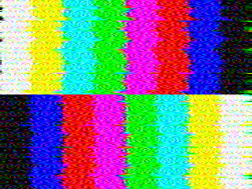

# Передача и приём SSTV-изображений с ESP32 и CC1101

**CC1101_SSTV** — проект для передачи цветных изображений по радио с помощью **ESP32-WROOM-32** и модуля **CC1101**. Используется телевидение с медленной развёрткой (SSTV, *Slow Scan Television*) в режиме **Robot 36**. ESP32 считывает пиксели из памяти и формирует последовательность тонов, а CC1101 передаёт её на частоте **433,920 МГц**. На приёмной стороне достаточно SDR-приёмника или радиостанции с узкополосной ЧМ (NFM) и SSTV-декодера. Из звука приёмника декодер восстанавливает кадр **320 × 240** примерно за **37 секунд**. Второй комплект ESP32 + CC1101 умеет искать сигнал по уровню, записывать его на компьютер через USB и восстанавливать картинку из WAV с помощью комплектного браузерного конвертера.

[Скачать проект целиком (ZIP)](https://github.com/Anton778/CC1101_SSTV/archive/refs/heads/main.zip) · [Конвертер картинки для передачи (Windows x64)](https://raw.githubusercontent.com/Anton778/CC1101_SSTV/main/SSTV_Converter.exe) · [Запись WAV и получение PNG](#опыт-с-двумя-платами-и-запись-без-звуковой-карты) · [Задания для занятия](#5-задания-для-занятия)

*Так выглядит штатный кадр до передачи по радио. Предпросмотр восстановлен из `image_data.h` с тем же выбором строк, что и в скетче.*

## 1. Подготовка изображения

Распакуйте ZIP проекта. Переименуйте папку `CC1101_SSTV-main`, в которой лежит скетч, в **`SSTV_Robot36_DDS`**. Откройте [SSTV_Robot36_DDS.ino](SSTV_Robot36_DDS.ino) в Arduino IDE. Рядом с ним должны находиться [image_data.h](image_data.h) и **вся папка [src](src/)**. Arduino IDE сама соберёт файлы из `src`. Для первой проверки можно передать штатную картинку выше.

### Настройки станции и учебный цикл

Для первой передачи оставьте значения по умолчанию. Для приёма и поиска измените режим в основном скетче и снова загрузите его на плату. В функции `loop()` можно проследить один проход по частотам и изменить алгоритм поиска.

| Строка скетча | Что меняется |
| --- | --- |
| `RADIO_MODE = SSTV_TX` | `SSTV_TX` передаёт картинку. `SSTV_RX` принимает на выбранном канале и поддерживает запись по USB. `SSTV_SCAN` измеряет уровень на нескольких частотах. |
| `CARRIER_FREQ_MHZ = 433.920` | Частота канала в МГц. На передатчике и приёмнике задайте один номинал. |
| `TX_POWER_DBM = 0` | Мощность передатчика в дБм. RadioLib 8.0.0 поддерживает значения −30, −20, −15, −10, 0, 5, 7 и 10. |
| `FREQ_OFFSET_KHZ = 0.0` | Поправка конкретного CC1101 в кГц. Плюс повышает частоту, минус понижает. Действует и на передачу, и на приём. |
| `FRAME_PAUSE_S = 10` | Пауза в секундах от конца кадра до начала следующего. Сам кадр длится 36,91 с. |
| `SCAN_START_KHZ`, `SCAN_END_KHZ`, `SCAN_STEP_KHZ` | Начало, конец и шаг прохода приёмника **в кГц**. В примере 433720…434120 с шагом 25. |

### Своя картинка

1. Подготовьте файл **PNG, JPG/JPEG или BMP**. Чтобы сохранить пропорции на экране приёмника, заранее кадрируйте изображение до **4:3**, например до 640 × 480 пикселей.
2. Запустите **`SSTV_Converter.exe`** в Windows x64. Python устанавливать отдельно не требуется. В окне «Выберите картинку для передачи по SSTV» откройте подготовленный файл.
3. Конвертер автоматически сохранит **`image_data.h` в папке исходной картинки**. Полный путь появится в сообщении «Готово!». При повторной обработке в той же папке программа перезаписывает этот файл.
4. Скопируйте полученный `image_data.h` в рабочую папку `SSTV_Robot36_DDS` рядом с `.ino`, заменив рабочую копию примера. После каждой смены изображения заново загрузите скетч в ESP32.

Конвертер масштабирует весь рисунок до **320 × 256** и записывает пиксели по строкам в массив `image_map`. Один пиксель занимает 16 бит в формате **RGB565** — 5 бит красного, 6 зелёного и 5 синего. Массив из 81 920 значений `uint16_t` занимает 160 КиБ в памяти прошивки. При передаче скетч выбирает из него 240 строк и по значениям пикселей формирует звуковые тоны SSTV.

## 2. Подключение CC1101

Понадобятся плата на классическом **ESP32-WROOM-32**, радиомодуль **CC1101 на диапазон 433 МГц**, антенна этого диапазона и USB-кабель для передачи данных. Соедините платы при отключённом питании.

| Вывод CC1101 | Вывод ESP32 | Назначение |
| --- | --- | --- |
| VCC | **3V3** | Питание 3,3 В |
| GND | GND | Общий провод |
| SCK / SCLK | GPIO18 | Тактовый сигнал SPI |
| SO / MISO | GPIO19 | Данные SPI от CC1101 к ESP32 |
| SI / MOSI | GPIO23 | Данные SPI от ESP32 к CC1101 |
| CSN / CS | GPIO21 | Выбор CC1101 на шине SPI |
| GDO0 | **GPIO4** | В TX сигнал идёт от ESP32 к CC1101, в RX демодулированный сигнал выходит из CC1101 |
| GDO2 | GPIO27 | Дополнительная сигнальная линия RadioLib |

Подключите антенну до подачи питания. В режиме `SSTV_TX` передача начинается автоматически после загрузки прошивки. Для работы в эфире выберите частоту, мощность и режим работы, разрешённые в месте проведения опыта.

## 3. Сборка и загрузка в Arduino IDE

1. В настройках Arduino IDE добавьте в список дополнительных адресов менеджера плат `https://espressif.github.io/arduino-esp32/package_esp32_index.json`. В менеджере плат установите **esp32 by Espressif Systems** версии **3.1.3** (ветка 3.x). [Инструкция Espressif](https://docs.espressif.com/projects/arduino-esp32/en/latest/installing.html)
2. Через менеджер библиотек установите **RadioLib** автора **Jan Gromeš**, версия **8.0.0**. Скетч использует интерфейс конфигурации `ConfigFSK_t` и вызов `transmitDirectAsync()`. [RadioLib 8.0.0](https://github.com/jgromes/RadioLib/releases/tag/8.0.0)
3. Откройте `SSTV_Robot36_DDS/SSTV_Robot36_DDS.ino`. В Arduino IDE выберите плату **ESP32 Dev Module** и USB-порт подключённой платы.
4. Нажмите **Проверить**, затем **Загрузить**. Откройте монитор порта на **115200 бод**. Во всех трёх режимах успешная настройка даёт `radio.begin = 0` и `setFrequencyDeviation = 0`. В TX появятся `DDS tick: 80000 Гц`, а при начале кадра — `TX START` и `transmitDirectAsync = 0`. В RX появятся `receiveDirectAsync = 0` и показания RSSI в дБм.

Все три режима собраны для `esp32:esp32:esp32` (ESP32 Dev Module) с Arduino-ESP32 3.1.3 и RadioLib 8.0.0.

## 4. Приём изображения

| Настройка | Значение для штатного скетча |
| --- | --- |
| Частота приёмника | **433,920 МГц** |
| Демодуляция | **NFM** (узкополосная ЧМ) |
| Полоса канального фильтра SDR | **12–15 кГц** |
| Шумоподавитель (squelch) | **Выключен**, чтобы сохранить начало кадра |
| Режим SSTV-декодера | **Robot 36** или автоопределение по заголовку VIS |

**На телефоне.** Откройте приложение Robot36 для Android, выберите микрофон и разрешите доступ к нему. Поднесите телефон к динамику радиостанции или компьютера с SDR и установите умеренную громкость. [Robot36 для Android](https://github.com/xdsopl/robot36)

**На компьютере.** Направьте звуковой выход SDR-программы на вход SSTV-декодера, например MMSSTV для Windows. При использовании виртуального аудиокабеля выберите его воспроизводящий конец в SDR-программе, а записывающий — в декодере. [MMSSTV](https://hamsoft.ca/pages/mmsstv.php)

В начале передачи ESP32 посылает заголовок **VIS = 8** длительностью 0,91 с. Затем идут **240 строк по 150 мс**. Кадр вместе с заголовком занимает **36,91 с**, после чего передатчик делает паузу (по умолчанию **10 с**) и повторяет изображение. Если декодер включился в середине передачи, оставьте его работать до начала следующего кадра.

### Опыт с двумя платами и запись без звуковой карты

1. Загрузите на первую плату `SSTV_TX`, на вторую — `SSTV_RX`. Укажите обеим одну номинальную частоту в `CARRIER_FREQ_MHZ`, например `433.920`. У каждого CC1101 своя `FREQ_OFFSET_KHZ`.
2. Проверьте вторую плату в мониторе порта на **115200 бод**. Раз в 250 мс появляется **RSSI** — уровень принятого сигнала в дБм. Например, −55 дБм выше −85 дБм. Сравните кадр и паузу, затем **закройте монитор порта**, чтобы освободить порт для записи.
3. На компьютере откройте файл [tools/receiver/index.html](tools/receiver/index.html) **из распакованной папки проекта** в настольном Chrome или Edge. Оставьте соседние файлы конвертера в той же папке. Обработка идёт локально. Компьютеру достаточно USB-соединения с приёмной ESP32.
4. В разделе **«Запись с платы»** нажмите **«Выбрать порт и записать»** и выберите порт второй ESP32. Удобно начать запись до включения передатчика. Для уже работающего передатчика со штатной паузой 10 с оставьте **90 с**: даже если начать сразу после заголовка, в файл попадёт следующий полный кадр. Если вы увеличили паузу, начните запись до передачи. После проверки целостности нажмите **«Сохранить принятый WAV»**.
5. В разделе **«Изображение из WAV»** выберите только что сохранённый файл и нажмите **«Декодировать кадр»**, затем **«Сохранить PNG»**. Конвертер ищет заголовок **VIS = 8**, проверяет чётность, синхронизируется по строкам и восстанавливает первый полный распознанный кадр **320 × 240**. Под изображением указаны время начала заголовка и число строк, в которых найден синхроимпульс.

Для проверки без плат нажмите **«Скачать контрольный WAV»** и выполните шаг 5. На экране появятся восемь цветных полос, в нижней половине кадра их порядок обращён. Можно открыть и запись звукового выхода SDR: обычный WAV PCM или float32, моно или стерео, 8–96 кГц, до 180 с. Для стереозаписи программа усредняет левый и правый каналы.

**Два конвертера решают разные задачи.** `SSTV_Converter.exe` готовит `image_data.h` из картинки **для передачи**. Папка `tools/receiver` содержит конвертер **для приёма**: он записывает WAV и создаёт PNG. ESP32 считывает уровень GDO0 с частотой 32 кГц, упаковывает восемь отсчётов в байт и отправляет их через USB. Компьютер сохраняет монофонический WAV PCM16. Для записи достаточно уже подключённого GPIO4.

### Приём через линейный вход

Для приёма через **линейный вход компьютера** соедините GDO0 через резистор 10 кОм с верхним выводом резистора 1 кОм, а его нижний вывод — с GND. Из точки соединения резисторов подайте сигнал через неполярный конденсатор 1 мкФ на один канал LINE IN, общий контакт входа соедините с GND. Такой делитель снижает размах примерно до 0,3 В. В MMSSTV выберите этот линейный вход и режим Robot 36.

### Подстройка передатчика под канал рации

Если вы уже откалибровали передатчик в предыдущей версии, перенесите значение `TX_FREQ_OFFSET_KHZ` без изменения знака в `FREQ_OFFSET_KHZ`.

1. Для нового модуля настройте рацию на нужный канал, укажите ту же частоту в `CARRIER_FREQ_MHZ` и загрузите прошивку с `FREQ_OFFSET_KHZ = 0.0`. С нуля следует начать и при переходе с самой первой версии, где `RADIOLIB_UNIT_MEGA(433.920f)` из RadioLib 8.0.0 задавал 433,000 МГц.
2. Во время передачи измерьте на откалиброванном SDR центр спектра сигнала. Например, если при канале **433,920 МГц** центр виден на **433,9275 МГц**, сигнал выше на 7,5 кГц. Введите `FREQ_OFFSET_KHZ = -7.5`. При повторной подстройке прибавьте к текущей поправке разность «частота канала минус измеренный центр», выраженную в кГц.
3. Снова загрузите скетч и проверьте приём на том же канале рации. В мониторе порта на **115200 бод** появятся номинал канала, поправка и частота, переданная в RadioLib. В примере последнее значение составит **433,912500 МГц**. Фактический центр сигнала проверьте по SDR.

Если под рукой только рация, откройте её шумоподавитель и подбирайте поправку небольшими шагами, например по 1 кГц в обе стороны. Сравнивайте устойчивость декодирования полного кадра Robot 36 при одной и той же настройке рации.

## 5. Задания для занятия

### Найти частоту учебного передатчика

1. Преподаватель включает свою плату в `SSTV_TX` на одном из каналов учебного диапазона. На плате ученика выберите `SSTV_SCAN`. Приёмник обходит диапазон от `SCAN_START_KHZ` до `SCAN_END_KHZ` с шагом `SCAN_STEP_KHZ`. Штатный проход охватывает 17 точек.
2. Откройте монитор порта. В цикле `for` переменная `f` задаёт частоту в кГц. Функция `measureReceiveRssi(f)` перестраивает приёмник и усредняет четыре отсчёта RSSI. Условие `if (rssi > strongest)` запоминает наибольшее значение и соответствующую частоту. При разнице между максимумом и минимумом прохода от 6 дБ скетч печатает кандидата.
3. Измените шаг с 25 до 50 кГц. Предскажите число точек и проверьте его по одному проходу. Добавьте в скетч переменную-счётчик: обнулите её перед `for`, увеличивайте на единицу в теле цикла и выводите после цикла. Сравните проходы во время передачи и в паузе.
4. Максимум RSSI показывает присутствие энергии в полосе фильтра. При полосе CC1101 около 58 кГц несколько соседних точек могут дать близкие показания. Сравните несколько проходов. Если точки 433895, 433920 и 433945 кГц дают почти одинаковый максимум, начните со средней и проверьте её записью полного кадра в `SSTV_RX`. Для 433920 кГц укажите `CARRIER_FREQ_MHZ = 433.920`. Появление своей картинки подтверждает, какой передатчик вы приняли.

### Исследовать помеху со свипом в записи

Откройте чистый WAV, декодируйте его и сохраните исходный PNG. В разделе **«Опыт со свипом»** задайте, например, границы **1100–2300 Гц**, период **2 с** и амплитуду **60 %** от пика исходной записи. Нажмите **«Сохранить WAV со свипом»**. Откройте полученную копию с суффиксом `-sweep.wav` и декодируйте её тем же способом. Опыт моделирует добавление звуковой помехи **после ЧМ-демодуляции** и выполняется целиком на компьютере.

Оба кадра ниже получены из одной контрольной фонограммы этим конвертером.

| Чистая запись | Копия со свипом 1100–2300 Гц, 2 с, 60 % |
| --- | --- |
|  |  |

В файле [sweep.js](tools/receiver/sweep.js) найдите цикл `for`. На каждом отсчёте он прибавляет тон к сигналу и изменяет частоту. У верхней границы `direction` становится −1, у нижней — +1. При периоде 2 с подъём занимает 1 с, спуск — ещё 1 с.

| Что изменить за один опыт | Что записать в отчёт |
| --- | --- |
| Амплитуда 0, 30 и 60 % при одном периоде | Сравните цвета полос и подпишите участки искажений. |
| Период 1, 2 и 4 с при одной амплитуде | Измерьте расстояние между повторяющимися искажениями в строках изображения. |
| Верхняя и нижняя границы звуковой частоты | Отметьте, распознался ли VIS и сколько строк сохранили синхронизацию. |

## Как формируется радиосигнал

Функции Arduino `setup()` и `loop()` находятся в [учебном скетче](SSTV_Robot36_DDS.ino). Формирование кадра и настройка CC1101 вынесены в [src/SstvRadio.cpp](src/SstvRadio.cpp), оцифровка GDO0 и обмен с компьютером — в [src/RxCapture.cpp](src/RxCapture.cpp). Аппаратный таймер ESP32 с частотой **80 кГц** управляет прямым цифровым синтезом (DDS). На GPIO4 формируется меандр, частота которого меняется с сохранением фазы. CC1101 работает в асинхронном режиме 2-FSK с заданной девиацией **±2 кГц**. После ЧМ-демодуляции приёмник воспроизводит тоны SSTV. Импульс **1200 Гц** отмечает начало строки, тоны **1500–2300 Гц** кодируют яркость и цветность. Яркость передаётся в каждой строке, а компоненты цветности R−Y и B−Y чередуются.

Штатная выходная мощность 0 дБм соответствует 1 мВт.

## Диагностика первого запуска

| Наблюдение | Что проверить |
| --- | --- |
| При сборке не найден `src/SstvRadio.h`, `image_data.h` или функция `setup()` | Проверьте, что рядом с `.ino` находятся `image_data.h` и папка `src` целиком. |
| Ошибка `static_assert` с упоминанием 320×256 | Повторите преобразование исходника штатным конвертером. Скетч ожидает ровно 81 920 пикселей RGB565. |
| Ошибка сборки в `timerBegin` или `ConfigFSK_t` | Проверьте выбранную плату, версию пакета ESP32 и версию RadioLib из раздела 3. |
| `radio.begin` возвращает ненулевой код | Проверьте питание 3,3 В, общий провод и четыре линии SPI. Сверьте маркировку SI и SO на модуле и убедитесь, что CSN подключён к GPIO21. |
| В спектре есть сигнал, но декодер не начинает кадр | Выберите NFM, подстройтесь по центру сигнала, отключите squelch и проверьте поступление звука на выбранный вход декодера до начала следующего VIS. |
| Конвертер не видит USB-порт | Откройте локальную страницу в настольном Chrome или Edge, закройте монитор и плоттер Arduino IDE, проверьте USB-кабель и режим `SSTV_RX`. |
| При записи появилась ошибка `OVERRUN` или запрос повторить приём | Освободите порт, повторите запись с начала и дождитесь ссылки на полный WAV. |
| Конвертер сообщает об отсутствии VIS или обрыве кадра | Проверьте канал и поправку. Запустите приём до начала передачи и захватите все 36,91 с кадра. Сначала проверьте декодирование контрольного WAV. |
| Кадр распознаётся, но покрыт шумом | При близком передатчике уменьшите усиление SDR. При акустическом приёме снизьте громкость до исчезновения искажений. Для проверки звукового тракта на компьютере передайте звук через виртуальный аудиокабель. |

После каждого кадра монитор порта выводит фактическую длительность передачи, число опозданий больше 50 мкс и максимальное опоздание. Эти значения помогают отличить нарушения временной сетки на ESP32 от искажений на стороне приёма.
